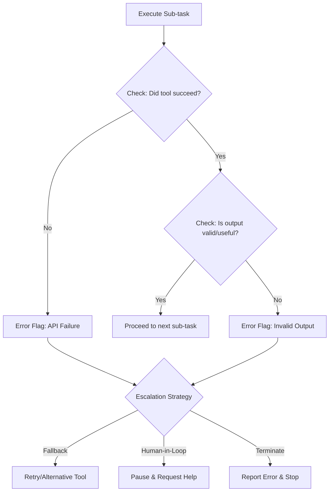

<h1>
  <span class="headline">Agentic Thinking & Task Decomposition</span>
  <span class="subhead">From Ambiguity to Clarity</span>
</h1>

**Learning objective:** By the end of this lesson, students will be able to decompose complex business requests using a systematic 4-step framework and implement proper boundary conditions for agent workflows.

## Interactive Exercise (5 minutes)

**Scenario:** You receive this vague business request:

> "Find out why our new feature is underperforming and suggest what to do about it."

**Your Task:** Write down the first three questions you would ask to clarify this task.

*Think about it for a moment, then continue reading...*

---

## Part 1: The 4-Step Decomposition Framework

To move from a vague goal to a clear plan, we need a structured approach. Every complex task can be broken down using this four-part framework:

### 1. **Goal**: Define the final, unambiguous end-state
- What does success look like?
- What specific output do you need?

### 2. **Sub-tasks**: Break the goal into smallest possible, independent steps
- Each step should be atomic and executable
- Trade-off: granularity vs. latency

### 3. **Tools**: Assign one specific, well-understood tool to each sub-task
- Examples: `sql_query`, `vector_search`, `api_call`
- Each tool should have clear inputs/outputs

### 4. **Checks**: Define verification after each action
- How does the agent know the tool worked?
- When should it proceed vs. escalate?

## Micro-Lab: Decompose a Task (8 minutes)

**Business Request:** 
> "Summarize today's news about our main competitor and check if their stock price has changed."

Using the 4-step framework, decompose this request:

**Goal:**
```
[Your answer here]
```

**Sub-tasks:**
```
1. [Your answer here]
2. [Your answer here]
3. [Your answer here]
```

**Tools:**
```
1. [Your answer here]
2. [Your answer here] 
3. [Your answer here]
```

**Checks:**
```
1. [Your answer here]
2. [Your answer here]
3. [Your answer here]
```

---

## Part 2: Defining Boundaries—When to Pause or Escalate

A robust agent knows when to stop. The "Checks" in our framework are triggers for boundaries.

When a check fails, the agent must decide on an escalation path:

| Failure Flag | Description | Escalation Pattern |
|--------------|-------------|-------------------|
| **API/Tool Error** | Tool fails to execute (timeout, 500 error) | **Fallback**: Retry or use alternative tool. If persists, terminate and report |
| **Empty/Invalid Result** | Tool runs but returns no/unexpected data | **Human-in-the-Loop**: Pause and ask for clarification |
| **Ambiguous Intent** | Agent cannot determine next step confidently | **Human-in-the-Loop**: Escalate for decision |

## Part 3: Decision Flow Visualization



## Part 4: Agentic Thinking in Practice

Let's apply this framework to a realistic business query:

**Business Goal:** "Why did our customer churn rate increase last quarter? Summarize key reasons from user feedback and draft an email to the product team."

```python
# Agent's internal monologue and execution plan

# --- Initial Goal Received ---
goal = "Why did churn increase last quarter? Summarize reasons and draft email."

# --- Agent's Execution Plan ---

# Thought 1: First, verify there *was* an increase
# Sub-task: Get churn rates for last two quarters. Tool: SQL Database
sub_task_1 = sql_query_tool(
    "SELECT quarter, churn_rate FROM quarterly_metrics ORDER BY quarter DESC LIMIT 2;"
)
if not sub_task_1 or len(sub_task_1) < 2:
    escalate("Failed to retrieve churn data from database.")  # Escalation: Terminate

# Thought 2: Data confirms increase. Now need the 'why' from user feedback
# Sub-task: Search knowledge base for churn reasons. Tool: RAG Vector Search
sub_task_2 = rag_retriever(
    "Find documents from Q2 mentioning 'cancel', 'bug', 'price', 'missing feature'."
)
if not sub_task_2:
    escalate("No relevant user feedback found. Proceed with churn increase only?")  # Human-in-the-Loop

# Thought 3: Have 15 relevant documents. Now synthesize and draft
# Sub-task: Summarize content and write draft. Tool: LLM Generation
context = "Context: " + "".join(sub_task_2)
prompt = "Summarize key churn reasons from context. Draft concise email to product team."
sub_task_3 = llm_generate_tool(prompt, context)
if "Email Draft" not in sub_task_3:
    escalate("Failed to generate summary and email draft.")  # Fallback: retry with simpler prompt

# --- Final Answer ---
# Thought 4: All steps complete. Present final answer
print(sub_task_3)
```

## Key Takeaways

1. **Structure beats creativity** - A systematic framework outperforms ad-hoc prompting
2. **Granularity matters** - Balance between atomic tasks and execution speed
3. **Always plan for failure** - Define clear escalation paths before execution
4. **Verification is crucial** - Each step must include success/failure checks

## Practice Exercise

Take this business request and apply the 4-step framework:

> "Our website traffic dropped 20% last week. Figure out what happened and recommend fixes."

Try decomposing this on your own before moving to the next lesson!
