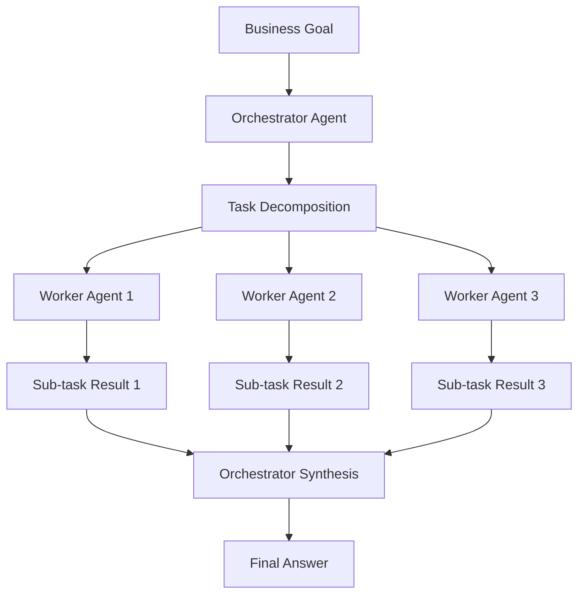

<h1>
  <span class="headline">Agentic Thinking & Task Decomposition</span>
  <span class="subhead">Orchestrator & Worker Patterns</span>
</h1>

**Learning objective:** By the end of this lesson, students will understand how to implement cost-effective multi-agent architectures using orchestrator/worker patterns and recognize the importance of reproducibility in agentic systems.

## Prerequisites: Setting up Google Colab Secrets

**Before starting, set up your OpenAI API key securely:**

1. **Get your OpenAI API key:**
   - Go to [OpenAI Platform](https://platform.openai.com/api-keys)
   - Create an account or log in
   - Generate a new API key (starts with `sk-`)
   - Copy the key (you'll only see it once!)

2. **Add the key to Google Colab Secrets:**
   - Open this notebook in Google Colab
   - Click the 🔑 **key icon** in the left sidebar
   - Click **"Add new secret"**
   - Name: `OPENAI_API_KEY`
   - Value: paste your API key
   - Enable the **"Notebook access"** toggle
   - Click **"Save"**

3. **Verify the setup:**
   - The key icon should show "1 secret" 
   - You're ready to run the cells below!

> **Why use Secrets?** Google Colab Secrets keep your API keys secure and prevent them from being accidentally shared or exposed in notebooks.

## Google Colab Setup

### Cell 1: Install Dependencies
```python
# Install required packages
!pip install openai==1.88.0 python-dotenv==1.0.0

import os
import json
import time
import logging
from typing import List, Dict, Any
from datetime import datetime
```

### Cell 2: API Key Setup
```python
# Load OpenAI API key from Google Colab Secrets
from google.colab import userdata
import getpass

try:
    api_key = userdata.get('OPENAI_API_KEY')
    os.environ['OPENAI_API_KEY'] = api_key
    print("OpenAI API key loaded from Colab Secrets")
except:
    # Fallback if secrets not configured
    api_key = getpass.getpass("Enter your OpenAI API key: ")
    os.environ['OPENAI_API_KEY'] = api_key
    print("API key entered manually")

# Verify key format
if not os.environ['OPENAI_API_KEY'].startswith('sk-'):
    raise ValueError("Invalid API key format")

print("API key configured successfully")
```

### Cell 3: Initialize OpenAI Client
```python
from openai import OpenAI

# Initialize OpenAI client
client = OpenAI()  # API key is automatically read from environment

# Test the connection
try:
    response = client.chat.completions.create(
        model="gpt-3.5-turbo",
        messages=[{"role": "user", "content": "Hello! Just testing the connection."}],
        max_tokens=50
    )
    print("OpenAI connection successful!")
    print(f"Test response: {response.choices[0].message.content}")
except Exception as e:
    print(f"Connection failed: {e}")
```

## The Orchestrator/Worker Agent Pattern

Decomposing tasks enables a powerful and cost-efficient multi-agent architecture. Instead of one giant, expensive model for everything, we use different agents for different jobs.

### Architecture Overview



### Role Definitions

#### The Orchestrator Agent
- **Role:** Project manager and strategic planner
- **Model:** Sophisticated (e.g., GPT-4, GPT-4-turbo)
- **Responsibilities:**
  - High-level task decomposition
  - Workflow coordination
  - Error handling and escalation
  - Final synthesis of results

#### Worker Agents
- **Role:** Task specialists and executors
- **Model:** Simpler, faster (e.g., GPT-3.5-turbo)
- **Responsibilities:**
  - Execute single, well-defined sub-tasks
  - API calls and data retrieval
  - Simple transformations and formatting
  - Status reporting back to orchestrator

## Cost Efficiency Analysis

This division of labor is highly efficient because it matches cost to complexity:

| Role | Example Model | Approx. Cost (per 1M tokens) | Strengths |
|------|---------------|------------------------------|-----------|
| **Orchestrator** | GPT-4-turbo | $10 Input / $30 Output | High-level reasoning, planning, decomposition |
| **Worker** | GPT-3.5-turbo | $0.50 Input / $1.50 Output | Fast, cheap execution of specific tasks |

### Cost Savings Example

**Scenario:** Analyze 100 customer support tickets

**Single-Agent Approach:**
- Model: GPT-4-turbo for everything
- Token usage: ~500K tokens total
- Cost: ~$20.00

**Multi-Agent Approach:**
- Orchestrator: 50K tokens (planning) = ~$2.00
- Workers: 450K tokens (execution) = ~$0.90
- **Total Cost: ~$2.90**
- **Savings: 85%**

## Implementation Pattern

### Cell 4: Base Agent Class with Cost Tracking
```python
class CostTracker:
    """Track costs for multi-agent execution"""
    
    def __init__(self):
        # OpenAI pricing (per 1M tokens)
        self.pricing = {
            'gpt-4': {'input': 10.00, 'output': 30.00},
            'gpt-3.5-turbo': {'input': 0.50, 'output': 1.50}
        }
        self.usage_log = []
    
    def estimate_tokens(self, text):
        """Rough token estimation (1 token ≈ 4 characters)"""
        return len(text) / 4
    
    def log_usage(self, model, input_text, output_text, agent_type):
        """Log token usage for cost calculation"""
        input_tokens = self.estimate_tokens(input_text)
        output_tokens = self.estimate_tokens(output_text)
        
        # Calculate cost
        input_cost = (input_tokens / 1_000_000) * self.pricing[model]['input']
        output_cost = (output_tokens / 1_000_000) * self.pricing[model]['output']
        total_cost = input_cost + output_cost
        
        usage_entry = {
            'agent_type': agent_type,
            'model': model,
            'input_tokens': int(input_tokens),
            'output_tokens': int(output_tokens),
            'cost': total_cost,
            'timestamp': datetime.now().isoformat()
        }
        
        self.usage_log.append(usage_entry)
        return usage_entry
    
    def get_cost_summary(self):
        """Generate cost analysis summary"""
        if not self.usage_log:
            return {"total_cost": 0, "total_tokens": 0, "orchestrator_cost": 0, "worker_cost": 0}
        
        total_cost = sum(entry['cost'] for entry in self.usage_log)
        total_tokens = sum(entry['input_tokens'] + entry['output_tokens'] for entry in self.usage_log)
        
        orchestrator_costs = [e for e in self.usage_log if e['agent_type'] == 'orchestrator']
        worker_costs = [e for e in self.usage_log if e['agent_type'] == 'worker']
        
        return {
            'total_cost': total_cost,
            'total_tokens': total_tokens,
            'orchestrator_cost': sum(e['cost'] for e in orchestrator_costs),
            'worker_cost': sum(e['cost'] for e in worker_costs),
            'cost_breakdown': self.usage_log
        }

# Global cost tracker
global_cost_tracker = CostTracker()

class BaseAgent:
    """Base class for all agents with common OpenAI functionality"""
    
    def __init__(self, model="gpt-3.5-turbo", temperature=0.1, agent_type="worker"):
        self.model = model
        self.temperature = temperature
        self.agent_type = agent_type
        self.client = client  # Use the global client
        
        # Setup logging
        logging.basicConfig(level=logging.INFO)
        self.logger = logging.getLogger(f"{self.__class__.__name__}")
    
    def call_llm(self, prompt, max_tokens=1000):
        """Make a call to OpenAI API with error handling and cost tracking"""
        try:
            self.logger.info(f"Calling {self.model} with prompt: {prompt[:100]}...")
            
            response = self.client.chat.completions.create(
                model=self.model,
                messages=[{"role": "user", "content": prompt}],
                temperature=self.temperature,
                max_tokens=max_tokens
            )
            
            result = response.choices[0].message.content
            
            # Track costs
            global_cost_tracker.log_usage(self.model, prompt, result, self.agent_type)
            
            self.logger.info(f"Response received: {result[:100]}...")
            return result
            
        except Exception as e:
            self.logger.error(f"API call failed: {e}")
            return f"Error: {str(e)}"

# Test the base agent
test_agent = BaseAgent()
test_response = test_agent.call_llm("What is 2+2?", max_tokens=50)
print(f"Test response: {test_response}")
print(f"Current cost: ${global_cost_tracker.get_cost_summary()['total_cost']:.4f}")
```

### Cell 5: Worker Agent Implementation
```python
class WorkerAgent(BaseAgent):
    """Worker agent for executing specific sub-tasks"""
    
    def __init__(self, agent_id=None):
        super().__init__(model="gpt-3.5-turbo", temperature=0.1, agent_type="worker")
        self.agent_id = agent_id or f"worker_{int(time.time())}"
    
    def execute(self, sub_task):
        """Execute single sub-task efficiently"""
        execution_prompt = f"""
        You are a specialist worker agent. Execute this specific task:
        
        Task: {sub_task['action']}
        Tool/Method: {sub_task['tool']}
        Expected Output Format: {sub_task['format']}
        Success Criteria: {sub_task['success_criteria']}
        
        Execute this task and return ONLY the requested output in the specified format.
        Be precise and concise.
        """
        
        result = self.call_llm(execution_prompt, max_tokens=500)
        
        # Log the execution
        self.logger.info(f"Worker {self.agent_id} completed task: {sub_task['action']}")
        
        return {
            'worker_id': self.agent_id,
            'task': sub_task['action'],
            'result': result,
            'timestamp': datetime.now().isoformat()
        }

# Test worker agent
test_worker = WorkerAgent("test_worker")
test_task = {
    'action': 'Calculate the sum of numbers 1 through 10',
    'tool': 'mathematical_calculation',
    'format': 'A single integer result',
    'success_criteria': 'Result should be exactly 55'
}

worker_result = test_worker.execute(test_task)
print("Worker Test Result:")
print(json.dumps(worker_result, indent=2))
```

### Cell 6: Orchestrator Agent Implementation
```python
class OrchestratorAgent(BaseAgent):
    """Orchestrator agent for high-level planning and coordination"""
    
    def __init__(self, num_workers=3):
        super().__init__(model="gpt-4", temperature=0.1, agent_type="orchestrator")  # Use GPT-4 for complex reasoning
        self.workers = [WorkerAgent(f"worker_{i}") for i in range(num_workers)]
        self.execution_log = []
    
    def decompose_task(self, business_goal):
        """Break down complex goal into sub-tasks"""
        decomposition_prompt = f"""
        You are an expert task orchestrator. Break down this business goal into 3-5 specific, executable sub-tasks.
        
        Business Goal: {business_goal}
        
        For each sub-task, provide a JSON object with these fields:
        1. "action": The specific action to take
        2. "tool": The tool/method to use
        3. "format": Expected output format
        4. "success_criteria": How to verify success
        
        Return your response as a valid JSON array of sub-task objects.
        """
        
        response = self.call_llm(decomposition_prompt, max_tokens=1000)
        
        try:
            # Parse the JSON response
            sub_tasks = json.loads(response)
            self.logger.info(f"Decomposed goal into {len(sub_tasks)} sub-tasks")
            return sub_tasks
        except json.JSONDecodeError:
            self.logger.error("Failed to parse decomposition response as JSON")
            # Fallback: create a simple decomposition
            return [{
                'action': f'Analyze: {business_goal}',
                'tool': 'analysis',
                'format': 'Structured analysis',
                'success_criteria': 'Clear insights provided'
            }]
    
    def validate_result(self, result, task):
        """Basic validation of worker results"""
        if not result or 'result' not in result:
            return False
        if len(result['result'].strip()) < 10:  # Too short
            return False
        return True
    
    def handle_failure(self, task, failed_result):
        """Handle worker failures with retry logic"""
        self.logger.warning(f"Task failed: {task['action']}")
        
        # Simple retry with different worker
        for worker in self.workers:
            if worker.agent_id != failed_result.get('worker_id'):
                retry_result = worker.execute(task)
                if self.validate_result(retry_result, task):
                    return retry_result
        
        # If all workers fail, return error result
        return {
            'worker_id': 'orchestrator',
            'task': task['action'],
            'result': f"Task failed after retries: {task['action']}",
            'timestamp': datetime.now().isoformat()
        }

# Test orchestrator decomposition
test_orchestrator = OrchestratorAgent(num_workers=2)
test_goal = "Analyze customer satisfaction from survey data and recommend improvements"

decomposed_tasks = test_orchestrator.decompose_task(test_goal)
print("Decomposed Tasks:")
print(json.dumps(decomposed_tasks, indent=2))
```

### Cell 7: Coordination and Execution
```python
class OrchestratorAgent(OrchestratorAgent):  # Extend the previous class
    
    def coordinate_execution(self, sub_tasks):
        """Assign tasks to workers and collect results"""
        results = []
        
        for i, task in enumerate(sub_tasks):
            # Assign task to worker (round-robin)
            worker = self.workers[i % len(self.workers)]
            
            self.logger.info(f"Assigning task {i+1} to {worker.agent_id}")
            result = worker.execute(task)
            
            # Validate result
            if not self.validate_result(result, task):
                self.logger.warning(f"Task validation failed, attempting recovery")
                result = self.handle_failure(task, result)
            
            results.append(result)
            self.execution_log.append({
                'task_index': i,
                'worker_id': result['worker_id'],
                'status': 'completed',
                'timestamp': result['timestamp']
            })
        
        return results
    
    def synthesize_results(self, results, original_goal):
        """Combine worker outputs into final answer"""
        
        # Prepare results summary for synthesis
        results_summary = []
        for i, result in enumerate(results):
            results_summary.append(f"Sub-task {i+1}: {result['result']}")
        
        synthesis_prompt = f"""
        You are an expert synthesizer. Combine these sub-task results into a comprehensive answer.
        
        Original Business Goal: {original_goal}
        
        Sub-task Results:
        {chr(10).join(results_summary)}
        
        Provide a comprehensive, actionable answer that addresses the original business goal.
        Include specific recommendations and next steps.
        """
        
        final_result = self.call_llm(synthesis_prompt, max_tokens=1500)
        
        return {
            'original_goal': original_goal,
            'sub_tasks_completed': len(results),
            'execution_log': self.execution_log,
            'final_answer': final_result,
            'timestamp': datetime.now().isoformat()
        }

# Test the complete workflow
print("Testing Complete Orchestrator Workflow...")

# Create new orchestrator instance
orchestrator = OrchestratorAgent(num_workers=3)

# Business goal
business_goal = "Create a marketing strategy for a new AI-powered fitness app"

# Step 1: Decompose
print("\nStep 1: Task Decomposition")
tasks = orchestrator.decompose_task(business_goal)
print(f"Decomposed into {len(tasks)} tasks")

# Step 2: Execute
print("\nStep 2: Coordinated Execution")
execution_results = orchestrator.coordinate_execution(tasks)
print(f"Completed {len(execution_results)} tasks")

# Step 3: Synthesize
print("\nStep 3: Result Synthesis")
final_output = orchestrator.synthesize_results(execution_results, business_goal)

print("\nFinal Result:")
print("="*50)
print(final_output['final_answer'])
print("="*50)
```

### Cell 8: Real-World Example - Customer Analysis Pipeline
```python
def create_customer_analysis_pipeline():
    """Create a realistic customer analysis example"""
    
    # Simulated customer data
    sample_data = {
        'survey_responses': [
            {'id': 1, 'rating': 4, 'comment': 'Great service, but could be faster'},
            {'id': 2, 'rating': 5, 'comment': 'Excellent experience, very satisfied'},
            {'id': 3, 'rating': 2, 'comment': 'Poor response time, frustrated'},
            {'id': 4, 'rating': 4, 'comment': 'Good overall, pricing could be better'},
            {'id': 5, 'rating': 3, 'comment': 'Average service, room for improvement'}
        ]
    }
    
    # Create specialized worker for data analysis
    class DataAnalysisWorker(WorkerAgent):
        def __init__(self):
            super().__init__("data_analyst")
            self.sample_data = sample_data
        
        def execute(self, sub_task):
            if 'survey data' in sub_task['action'].lower():
                # Simulate data retrieval
                result_text = f"Retrieved {len(self.sample_data['survey_responses'])} survey responses. Average rating: {sum(r['rating'] for r in self.sample_data['survey_responses']) / len(self.sample_data['survey_responses']):.1f}/5"
            else:
                # Use standard LLM execution
                return super().execute(sub_task)
            
            return {
                'worker_id': self.agent_id,
                'task': sub_task['action'],
                'result': result_text,
                'data': self.sample_data,
                'timestamp': datetime.now().isoformat()
            }
    
    # Create orchestrator with specialized worker
    orchestrator = OrchestratorAgent(num_workers=2)
    orchestrator.workers.append(DataAnalysisWorker())  # Add specialized worker
    
    return orchestrator

# Run customer analysis example
print("Customer Analysis Pipeline Example")
print("="*50)

customer_orchestrator = create_customer_analysis_pipeline()

customer_goal = "Analyze customer satisfaction trends and recommend specific improvements"

# Execute the pipeline
print("\n1. Decomposing customer analysis task...")
customer_tasks = customer_orchestrator.decompose_task(customer_goal)

print("\n2. Executing analysis tasks...")
customer_results = customer_orchestrator.coordinate_execution(customer_tasks)

print("\n3. Synthesizing customer insights...")
customer_analysis = customer_orchestrator.synthesize_results(customer_results, customer_goal)

print("\nCustomer Analysis Results:")
print("-" * 30)
print(customer_analysis['final_answer'])
```

### Cell 9: Live Cost Analysis
```python
# Run a quick task to demonstrate cost tracking
print("Running sample tasks to demonstrate cost tracking...")

# Reset cost tracker for clean demonstration
global_cost_tracker = CostTracker()

# Create agents
orchestrator = OrchestratorAgent(num_workers=2)
worker = WorkerAgent("demo_worker")

# Run some sample tasks
print("\n1. Orchestrator task (GPT-4):")
orchestrator_result = orchestrator.call_llm("Create a brief 3-step plan for launching a mobile app", max_tokens=200)

print("\n2. Worker tasks (GPT-3.5-turbo):")
worker_result1 = worker.call_llm("List 3 key features for a fitness app", max_tokens=100)
worker_result2 = worker.call_llm("Suggest 2 marketing channels for mobile apps", max_tokens=100)

# Show real cost analysis
cost_summary = global_cost_tracker.get_cost_summary()
print("\nReal Cost Analysis:")
print(f"Total Cost: ${cost_summary['total_cost']:.4f}")
print(f"Orchestrator Cost: ${cost_summary['orchestrator_cost']:.4f}")
print(f"Worker Cost: ${cost_summary['worker_cost']:.4f}")
print(f"Total Tokens: {cost_summary['total_tokens']:,}")

# Show detailed breakdown
print(f"\nDetailed Breakdown:")
for entry in cost_summary['cost_breakdown']:
    print(f"- {entry['agent_type']}: {entry['input_tokens']+entry['output_tokens']} tokens, ${entry['cost']:.4f}")
```

## Pattern Benefits

### 1. **Cost Optimization**
- Use expensive models only for complex reasoning
- Simple tasks handled by cheaper models
- Often 80-90% cost reduction

### 2. **Parallelization**
- Workers can execute sub-tasks simultaneously
- Faster overall completion time
- Better resource utilization

### 3. **Specialization**
- Each worker can be optimized for specific task types
- Different workers for different domains (SQL, API calls, text analysis)
- Better accuracy through specialization

### 4. **Fault Tolerance**
- If one worker fails, others continue
- Orchestrator can reassign failed tasks
- Graceful degradation instead of complete failure

## Reproducibility Best Practices

### Cell 10: Complete Reproducible Example
```python
class ReproducibleOrchestratorSystem:
    """Complete system with logging and reproducibility features"""
    
    def __init__(self, config=None):
        # Default configuration
        default_config = {
            "orchestrator_model": "gpt-4",
            "worker_model": "gpt-3.5-turbo",
            "temperature": 0.1,
            "max_retries": 3,
            "timeout": 30
        }
        self.config = config or default_config
        self.cost_tracker = global_cost_tracker
        self.setup_logging()
        
        # Initialize agents with fixed configuration
        self.orchestrator = OrchestratorAgent(num_workers=3)
        
        # Override models based on config
        self.orchestrator.model = self.config['orchestrator_model']
        self.orchestrator.temperature = self.config['temperature']
        
        for worker in self.orchestrator.workers:
            worker.model = self.config['worker_model']
            worker.temperature = self.config['temperature']
    
    def setup_logging(self):
        """Setup comprehensive logging"""
        logging.basicConfig(
            level=logging.INFO,
            format='%(asctime)s - %(name)s - %(levelname)s - %(message)s',
            handlers=[
                logging.StreamHandler(),
                logging.FileHandler('agent_execution.log')
            ]
        )
        self.logger = logging.getLogger('ReproducibleSystem')
    
    def execute_business_goal(self, goal):
        """Execute a business goal with full tracking"""
        self.logger.info(f"Starting execution of goal: {goal}")
        
        start_time = time.time()
        
        try:
            # Decompose
            tasks = self.orchestrator.decompose_task(goal)
            
            # Execute
            results = self.orchestrator.coordinate_execution(tasks)
            
            # Synthesize
            final_result = self.orchestrator.synthesize_results(results, goal)
            
            execution_time = time.time() - start_time
            
            # Add metadata
            final_result['execution_metadata'] = {
                'execution_time_seconds': execution_time,
                'config_used': self.config,
                'cost_summary': self.cost_tracker.get_cost_summary()
            }
            
            self.logger.info(f"Goal execution completed in {execution_time:.2f}s")
            return final_result
            
        except Exception as e:
            self.logger.error(f"Goal execution failed: {e}")
            raise

# Run a complete reproducible example
print("Running Complete Reproducible Example")
print("="*60)

system = ReproducibleOrchestratorSystem()

example_goal = "Develop a go-to-market strategy for an AI tutoring platform targeting university students"

final_result = system.execute_business_goal(example_goal)

print(f"\nExecution completed!")
print(f"Time: {final_result['execution_metadata']['execution_time_seconds']:.2f} seconds")
print(f"Estimated cost: ${final_result['execution_metadata']['cost_summary']['total_cost']:.4f}")

print(f"\nFinal Strategy:")
print("-" * 40)
print(final_result['final_answer'])
```

## Module 4.4 Checklist

Can you...

**Explain why ambiguity, not difficulty, is the primary cause of agent failure?**

**List the four parts of the task decomposition framework?**
1. Goal (define end-state)
2. Sub-tasks (break into atomic steps)  
3. Tools (assign specific capabilities)
4. Checks (define verification)

**Decompose a simple business request into a sequence of agent sub-tasks?**

**Describe the difference between an "Orchestrator" agent and a "Worker" agent and why this pattern is cost-effective?**

**Name two common agent failure flags and a corresponding escalation strategy for each?**
- API/Tool Error → Fallback (retry/alternative)
- Empty/Invalid Result → Human-in-the-Loop

### Cell 11: Interactive Practice Exercise
```python
# Interactive exercise for students
def practice_exercise():
    """Interactive practice with the orchestrator/worker pattern"""
    
    print("Practice Exercise: Design Your Own Multi-Agent System")
    print("="*60)
    
    # Get user input
    user_goal = input("Enter a business goal you'd like to decompose: ")
    
    if not user_goal.strip():
        user_goal = "Improve employee engagement in a remote work environment"
        print(f"Using default goal: {user_goal}")
    
    # Create system and execute
    practice_system = ReproducibleOrchestratorSystem()
    
    print(f"\nProcessing your goal: {user_goal}")
    result = practice_system.execute_business_goal(user_goal)
    
    print(f"\nResults Summary:")
    print(f"- Sub-tasks completed: {result['sub_tasks_completed']}")
    print(f"- Execution time: {result['execution_metadata']['execution_time_seconds']:.2f}s")
    print(f"- Estimated cost: ${result['execution_metadata']['cost_summary']['total_cost']:.4f}")
    
    print(f"\nGenerated Strategy:")
    print("-" * 50)
    print(result['final_answer'])
    
    return result

# Run the practice exercise
# Uncomment the line below to run the interactive exercise
# practice_result = practice_exercise()
print("Uncomment the line above to run the interactive practice exercise!")
```

## Next Steps

In our next modules, we will put this theory into practice. You will see how to implement these agentic workflows using code, connecting them to infrastructure and automating their deployment.

The foundation you've built here—thinking systematically about task decomposition and agent orchestration—will be essential for building production-ready AI systems.

## Additional Resources

### Useful Links for Further Learning:
- [OpenAI API Documentation](https://platform.openai.com/docs)
- [Best Practices for Multi-Agent Systems](https://arxiv.org/abs/2309.07870)
- [Cost Optimization Strategies](https://platform.openai.com/docs/guides/production-best-practices)

### Next Session Preparation:
- Set up your OpenAI API account with billing
- Practice using Google Colab Secrets for secure API key management
- Review the cost tracker implementation
- Think about a real business problem you'd like to solve with agents

### Security Best Practices:
- ✅ Always use Google Colab Secrets for API keys
- ✅ Never hard-code API keys in notebooks
- ✅ Regularly rotate your API keys
- ❌ Don't share notebooks with exposed API keys

**Congratulations!** You've successfully implemented a cost-effective multi-agent orchestrator/worker system!
